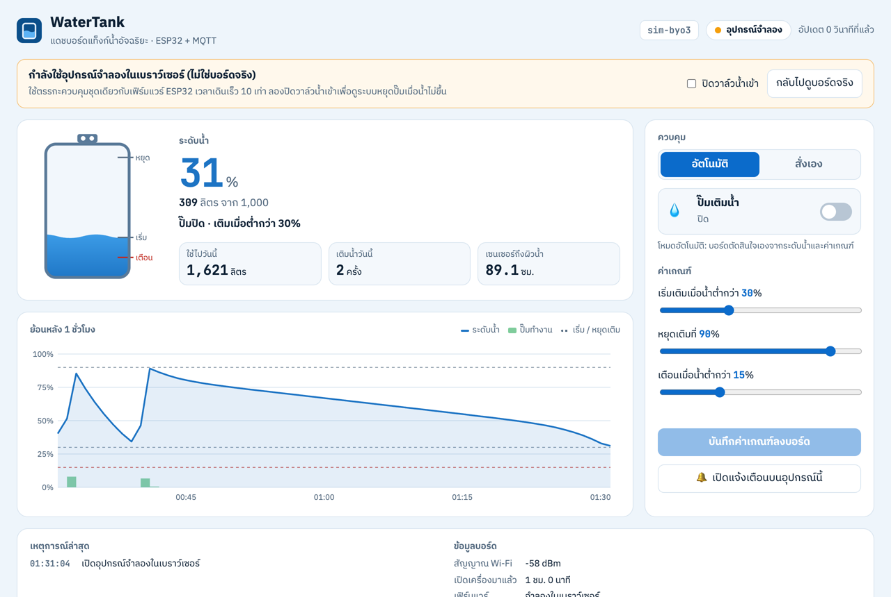
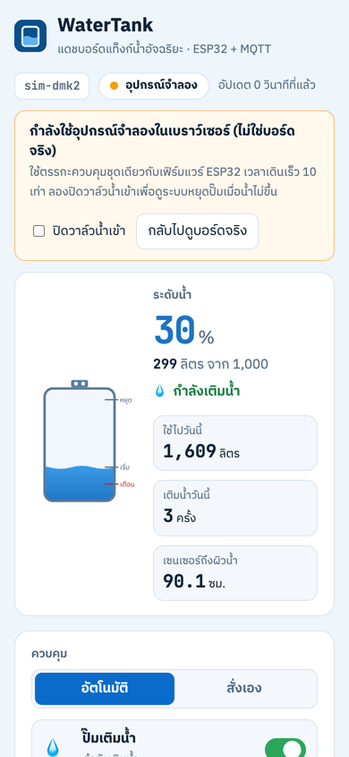

# WaterTank · แท็งก์น้ำอัจฉริยะ ESP32 + แดชบอร์ด MQTT

**แดชบอร์ด:** https://watertank-th.vercel.app (กด "เปิดอุปกรณ์จำลองในเบราว์เซอร์" ถ้าบอร์ดออฟไลน์)

ระบบดูแลแท็งก์น้ำบน ESP32 วัดระดับน้ำด้วยเซนเซอร์อัลตราโซนิกที่ฝาแท็งก์ เติมน้ำด้วยปั๊มเองเมื่อน้ำลดถึงค่าที่ตั้ง
หยุดปั๊มทันทีถ้าเปิดแล้วน้ำไม่ขึ้น (กันปั๊มทำงานแห้งจนไหม้) ส่งเสียงเตือนเมื่อน้ำใกล้หมด แสดงผลบนจอ OLED
และส่งข้อมูลผ่าน MQTT แบบเข้ารหัส (TLS) ไปยังหน้าเว็บ ดูระดับน้ำ สั่งปั๊ม ปรับค่าเกณฑ์ และรับแจ้งเตือนจากมือถือได้



## ทำอะไรได้บ้าง

- **วัดระดับน้ำ:** อ่านระยะจากเซนเซอร์ถึงผิวน้ำทุกวินาที กรองด้วยค่ามัธยฐาน 5 ค่า (ตัดเสียงสะท้อนผนังแท็งก์ที่หลุดมาเป็นครั้งคราว) แล้วแปลงเป็น % และลิตร
- **เติมน้ำอัตโนมัติ:** น้ำลดถึง 30% → เปิดปั๊ม เติมจนถึง 90% → ปิด (ช่วงห่างกันกันปั๊มติดดับถี่) ปรับค่าได้จากเว็บ บอร์ดจำค่าไว้แม้ไฟดับ
- **กันปั๊มทำงานแห้ง:** ระหว่างปั๊มทำงาน น้ำต้องขึ้นอย่างน้อย 2% ทุก 3 นาที ถ้าไม่ขึ้น (วาล์วปิด ท่อแตก น้ำประปาไม่ไหล) บอร์ดหยุดปั๊ม ล็อกไว้ และส่งเสียงเตือน จนกว่าจะกดล้างข้อผิดพลาด
- **ป้องกันอื่น ๆ:** ปั๊มทำงานต่อเนื่องได้ไม่เกิน 20 นาที, ไม่เติมเกินค่าหยุดแม้สั่งเอง, เซนเซอร์ไม่ตอบ 5 ครั้งติดหยุดปั๊มไว้ก่อน
- **เตือน:** บัซเซอร์ + ไฟแดงเมื่อน้ำต่ำกว่า 15% หรือมีข้อผิดพลาด กดปุ่มบนบอร์ดสั้น ๆ เพื่อปิดเสียง กดค้าง 2 วินาทีเพื่อล้างข้อผิดพลาด หน้าเว็บส่งการแจ้งเตือนเข้ามือถือ / คอมได้ (Notification API)
- **สถิติ:** น้ำที่ใช้ไปวันนี้ (ลิตร) และจำนวนครั้งที่เติม รีเซ็ตเที่ยงคืนตามเวลาไทย (NTP)
- **ทนเน็ตหลุด:** ควบคุมต่อได้แม้ไม่มีอินเทอร์เน็ต ต่อ Wi-Fi / MQTT ใหม่เอง และใช้ MQTT Last Will บอกสถานะออฟไลน์



## อุปกรณ์และการต่อวงจร

| อุปกรณ์ | ขา ESP32 | หมายเหตุ |
|---------|----------|----------|
| เซนเซอร์อัลตราโซนิก HC-SR04 | TRIG 5, ECHO 18 | งานจริงใช้ JSN-SR04T (กันน้ำ) และแบ่งแรงดัน ECHO ลง 3.3V |
| รีเลย์ปั๊ม (หรือโซลินอยด์วาล์ว) | GPIO 26 | ปั๊มใหญ่ให้รีเลย์สั่งแมกเนติกคอนแทคเตอร์อีกที |
| บัซเซอร์ | GPIO 27 | |
| LED ปั๊ม / LED เตือน | GPIO 25 / 33 | ผ่านตัวต้านทาน 220Ω |
| จอ OLED SSD1306 128×64 (I2C 0x3C) | SDA 21, SCL 22 | |
| ปุ่ม ปิดเสียง / ล้างข้อผิดพลาด | GPIO 4 → GND | ใช้ pull-up ภายใน |

ค่าแท็งก์อยู่ใน [`config.h`](firmware/watertank/config.h): ระยะเซนเซอร์ถึงก้นแท็งก์ (`TANK_EMPTY_CM`), ถึงผิวน้ำตอนเต็ม (`TANK_FULL_CM`) และความจุ (`TANK_LITRES`)

## MQTT

Broker: `broker.emqx.io` (TLS 8883 สำหรับบอร์ด, WebSocket 8084 สำหรับเว็บ) · base topic `watertank-th/<DEVICE_ID>`

| Topic | ทิศทาง | ข้อมูล |
|-------|--------|--------|
| `…/state` | บอร์ด → เว็บ ทุก 5 วินาที (retained) | `{"ts":1792330000,"level":56.4,"litres":564,"distance":63.6,"pump":false,"alarm":false,"fault":"none","mode":"auto","usedToday":312,"refillsToday":2,...}` |
| `…/status` | retained + Last Will | `online` / `offline` |
| `…/history` | ทุกนาที (retained) | `[[ts,level,pump%], …]` 60 จุดล่าสุด |
| `…/config` | retained | `{"mode":"auto","start":30,"stop":90,"alarm":15,"tankLitres":1000}` |
| `…/cmd` | เว็บ → บอร์ด | `{"mode":"manual"}`, `{"pump":true}`, `{"start":35,"stop":90,"alarm":15}`, `{"reset":true}`, `{"silence":true}` |

บอร์ดตรวจใบรับรองของ broker ด้วย root CA (DigiCert Global Root G2 ใน `certs.h`) ไม่ได้ปิดการตรวจ

## ทดสอบ

ตรรกะควบคุมทั้งหมดอยู่ใน [`control.h`](firmware/watertank/control.h) เป็น C++ ล้วนไม่เรียก Arduino จึงทดสอบบนคอมได้
และมี port เป็น JavaScript ([`dashboard/control.js`](dashboard/control.js)) ให้อุปกรณ์จำลองบนเว็บทำงานเหมือนบอร์ดทุกอย่าง

```bash
make test       # C++ 12 กลุ่ม + JavaScript 6 เคส: เติม/หยุดตามค่า, น้ำไม่ขึ้น, ปั๊มนานเกิน,
                # เซนเซอร์หาย, สั่งเองแต่ไม่ล้น, millis() วนรอบหลัง 49 วัน, นับน้ำที่ใช้
make compile    # คอมไพล์เฟิร์มแวร์ ESP32 (ARDUINO_CLI="/Applications/Arduino IDE.app/Contents/Resources/app/lib/backend/resources/arduino-cli" ถ้าใช้ตัวที่มากับ Arduino IDE 2)
```

ผลล่าสุด: ทดสอบผ่านทั้งหมด, คอมไพล์ผ่านด้วย esp32 core 3.3.11 (`--warnings all` ไม่มี warning) ใช้ flash 81%

## อุปกรณ์จำลองบนเว็บ

ถ้าบอร์ดออฟไลน์ กด **เปิดอุปกรณ์จำลองในเบราว์เซอร์** ได้เลย ใช้ตรรกะควบคุมชุดเดียวกับเฟิร์มแวร์ บนแท็งก์จำลอง 1,000 ลิตร
(ใช้น้ำมากช่วงเช้าและเย็น ปั๊มเติม 100 ลิตร/นาที เวลาเดินเร็ว 10 เท่า) ทำงานในเบราว์เซอร์ทั้งหมด ไม่ผ่าน broker
ลองติ๊ก **ปิดวาล์วน้ำเข้า** ตอนปั๊มกำลังเติม ประมาณ 18 วินาทีต่อมา ระบบจะหยุดปั๊มและขึ้นแถบเตือน

## ลองรันบอร์ดบน Wokwi

1. เปิด https://wokwi.com/projects/new/esp32
2. วางเนื้อหา [`wokwi/sketch.ino`](wokwi/sketch.ino) (สร้างจากไฟล์ใน `firmware/` ด้วย `make wokwi`) และ [`wokwi/diagram.json`](wokwi/diagram.json)
3. Library Manager: เพิ่มตามรายการใน [`wokwi/libraries.txt`](wokwi/libraries.txt)
4. กด ▶ แล้วคลิกที่เซนเซอร์ HC-SR04 เพื่อเลื่อนระยะ (ระยะ 86 ซม. = น้ำ 34%) ดูปั๊มเปิด/ปิดและค่าบนจอ OLED

## ใช้งานจริง

1. แก้ `config.h`: Wi-Fi (`WIFI_CHANNEL 0`), `DEVICE_ID`, ขนาดแท็งก์ และ broker ส่วนตัวพร้อม user/password
2. ติดเซนเซอร์กลางฝาแท็งก์ ห่างจากผนังและท่อน้ำเข้า วัด `TANK_EMPTY_CM` / `TANK_FULL_CM` จากของจริง
3. ใส่ลูกลอยไฟฟ้าตัดปั๊มเป็นชั้นป้องกันสุดท้ายเสมอ ไม่พึ่งซอฟต์แวร์อย่างเดียว
4. `make upload PORT=/dev/cu.usbserial-xxxx`

## ข้อจำกัด

- `broker.emqx.io` เป็น broker สาธารณะ ใครรู้ topic ก็อ่านหรือสั่งได้ และล่มได้โดยไม่บอกล่วงหน้า (19 ต.ค. 2569 ไม่ตอบการ subscribe แล้วปฏิเสธการเชื่อมต่อ) ใช้สำหรับเดโมเท่านั้น
- HC-SR04 ไม่กันน้ำ ไอน้ำในแท็งก์ทำให้อ่านค่าเพี้ยนได้ งานจริงควรใช้ JSN-SR04T หรือเซนเซอร์แรงดัน
- น้ำที่ใช้วันนี้คำนวณจากระดับที่ลดลงขณะปั๊มไม่ทำงาน ถ้ามีการใช้น้ำระหว่างเติมจะนับไม่ครบ

---

โครงสร้างโปรเจกต์ต่อยอดจาก [SmartFarm](https://github.com/chasvitf/smartfarm-iot) ของผมเอง ·
ทำโดย Chanavee Pimprong · [รับทำ Arduino / ESP32 / IoT บน Fastwork](https://fastwork.co/user/chasvitf/iot-13786561) · MIT License
